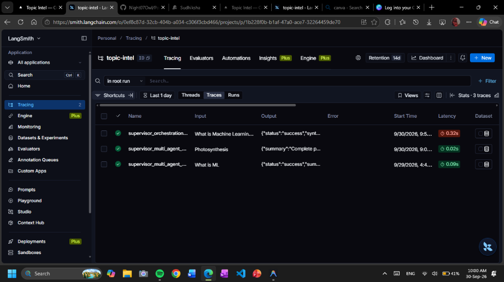
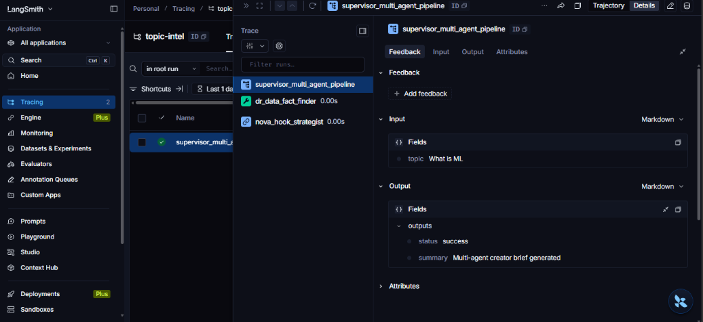

# LangSmith Multi-Agent Tracing & Observability

This directory documents the LangSmith tracing and observability setup for the **Creator Research Assistant** (`12_Creator_Research_Assistant`), showing end-to-end execution of the multi-agent pipeline under project `topic-intel`.

---

## 1. Traces Overview

The LangSmith dashboard monitors root orchestration runs and multi-agent pipelines executed by the Creator Research Assistant.

### Key Runs Logged:
- **`supervisor_orchestration_run`**: End-to-end pipeline execution for topics such as *"What is Machine Learning..."*.
- **`supervisor_multi_agent_pipeline`**: Modular multi-agent execution runs for topics like *"Photosynthesis"* and *"What is ML"*.
- **Metrics Tracked**: Execution latency, success status, input prompts, structured output summaries, and sub-agent call hierarchies.

---

## 2. Multi-Agent Pipeline Trace Detail

A deep-dive view into the `supervisor_multi_agent_pipeline` showing the decomposition and coordination across specialized agents:

### Execution Flow:
1. **Supervisor (`supervisor_multi_agent_pipeline`)**: Receives the topic input (e.g., `What is ML`).
2. **Fact-Finder Agent (`dr_data_fact_finder`)**: Extracts key facts, credible statistics, and core foundational information.
3. **Hook Strategist Agent (`nova_hook_strategist`)**: Formulates platform-tailored angles, hooks, and engagement strategies.
4. **Structured Output**: Produces a synthesized multi-agent creator brief (`Multi-agent creator brief generated`) with `status: success`.
